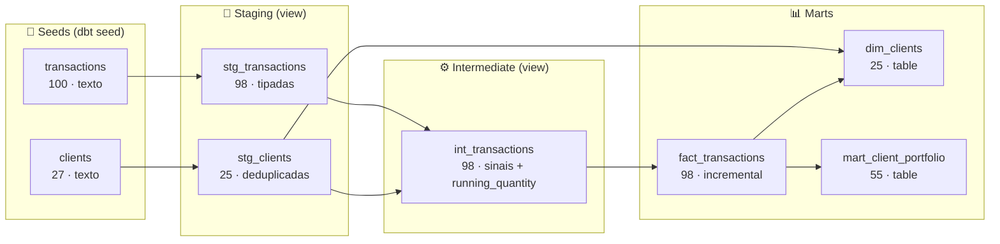

# Teste Técnico Engenheiro de Dados · Clube do Valor

Projeto dbt que transforma as transações e o cadastro de clientes de uma corretora fictícia em modelos analíticos, em três camadas (staging, intermediate, marts), com testes e documentação.

Os dados de entrada têm problemas de qualidade de propósito. Os CSVs estão em `seeds/` **exatamente como foram baixados**. Os testes do projeto sinalizam cada problema, e o staging filtra os registros inválidos via SQL.

**Vídeo de apresentação:** _(link do vídeo)_

---

## Resultado esperado (leia antes de rodar)

```
dbt seed   →  Done. PASS=2  WARN=0 ERROR=0
dbt run    →  Done. PASS=6  WARN=0 ERROR=0
dbt test   →  Done. PASS=52 WARN=7 ERROR=0     (código de saída 0)
```

**Os 7 WARN são os defeitos plantados nos dados, detectados pelos testes. Não são falhas do projeto.** Entre eles está o teste singular `assert_no_negative_position`, que encontra 6 clientes com posição negativa. A lista completa está em [O que esperar do `dbt test`](#dbt-test).

- **Por que WARN e não ERROR no teste singular?** O enunciado pede que o `dbt test` passe e que o teste singular detecte o problema. A severidade `warn` faz as duas coisas: o teste conta e grava as linhas encontradas, e o comando termina sem erro. Os testes dos meus modelos (staging, intermediate e marts) são `error`, e todos passam.
- **Quer ver o teste singular reprovar?** Rode `dbt test --vars '{negative_position_severity: error}'`. O comando termina com código 1.
- **T035 e T036** (iguais em tudo menos o ID) são mantidas e marcadas com `is_possible_duplicate`, porque duas ordens iguais no mesmo dia são possíveis. Para deduplicá-las, rode `dbt run --full-refresh --vars '{dedup_transactions_by_content: true}'`. A fact cai de 98 para 97 linhas.
- **Nenhum CSV foi editado.** Os registros inválidos são filtrados no staging via SQL e continuam sinalizados nos testes da fonte.

---

## Como rodar

### 1. Pré-requisitos

- **Python 3.10 a 3.13** (testado com 3.12 e 3.13). Confira com `python --version` ou `python3 --version`.
- **git**.
- Nada mais. O banco é **DuckDB**: um arquivo local (`cdv.duckdb`) criado na primeira execução. Não precisa de Docker, servidor nem credenciais.

### Atalho (Linux e macOS)

Um comando só cria o ambiente virtual, instala as dependências e roda `dbt seed`, `dbt run` e `dbt test`, sem precisar ativar nada:

```bash
git clone <url-deste-repositorio>
cd <pasta-do-repositorio>
bash scripts/rodar.sh
```

Os passos abaixo fazem o mesmo, manualmente.

### 2. Instalação

```bash
git clone <url-deste-repositorio>
cd <pasta-do-repositorio>

python3 -m venv .venv              # no Windows: python -m venv .venv
source .venv/bin/activate          # Linux e macOS
# .venv\Scripts\activate           # Windows (cmd)
# .venv\Scripts\Activate.ps1       # Windows (PowerShell)

pip install -r requirements.txt    # dbt-core 1.12.5 e dbt-duckdb 1.11.0
dbt --version                      # confere a instalação
```

Depois do `activate`, o prompt do terminal começa com `(.venv)`. **Em cada terminal novo é preciso ativar de novo** (`source .venv/bin/activate`), senão o comando `dbt` não é encontrado. Sem ativar, também funciona chamar `.venv/bin/dbt seed` e assim por diante.

No Ubuntu e no Debian, o `python3 -m venv` pode falhar com `ensurepip is not available`. Nesse caso, instale o pacote do venv (`sudo apt install python3-venv`) e crie o `.venv` de novo.

Não é preciso configurar nada em `~/.dbt`. O `profiles.yml` fica na raiz do projeto, e o dbt o encontra ali quando os comandos são rodados desta pasta. O projeto não usa pacotes externos, então **não é preciso rodar `dbt deps`**.

### 3. Os três comandos

```bash
dbt seed
dbt run
dbt test
```

Os três terminam **sem erro** (código de saída 0). Se preferir um comando só, `dbt build` faz os três em ordem.

---

## Fluxo de dados



**Legenda:** staging e intermediate são `view`; `dim_clients` e `mart_client_portfolio` são `table`; `fact_transactions` é `incremental`. Os marts seguem o estilo Kimball: o portfólio e as métricas de atividade da `dim_clients` leem da fato (D22). A `dim_clients` lê de duas fontes: `stg_clients` para o cadastro e `fact_transactions` para as métricas de atividade. É isso que mantém na dimensão os 15 clientes que nunca operaram.

---

## O que esperar de cada comando

### `dbt seed`

Carrega `transactions.csv` (100 linhas) e `clients.csv` (27 linhas).

```
Done. PASS=2 WARN=0 ERROR=0
```

### `dbt run`

Constrói os 6 modelos.

```
Done. PASS=6 WARN=0 ERROR=0
```

### `dbt test`

```
Done. PASS=52 WARN=7 ERROR=0
```

**Os 7 avisos (WARN, em amarelo) são esperados: são os testes encontrando os problemas plantados nos dados.** Nenhum teste dá erro.

| Teste | Achados | O que encontrou |
|---|---|---|
| `assert_no_negative_position` (teste singular obrigatório) | 6 | Clientes que terminam vendidos em um ativo: C1 BBDC4 (-50), C3 WEGE3 (-30), C5 BBDC4 (-400), C6 ITUB4 (-50), C7 WEGE3 (-60), C8 VALE3 (-30) |
| `assert_no_negative_running_position` (extra) | 11 | Transações em que a posição ficou negativa em algum momento, mesmo que depois tenha se recomposto |
| `not_null_transactions_client_id` | 1 | T021 sem cliente |
| `positive_value_transactions_quantity` | 1 | T037: compra com quantidade -50 |
| `transactions_unique_content_except_id` | 1 | T035 e T036 iguais em tudo menos o ID |
| `unique_clients_client_id` | 2 | C1 e C6 aparecem duas vezes no cadastro |
| `not_null_clients_city` | 1 | A segunda cópia de C6 está sem cidade |

Note que o teste singular encontra **6** posições negativas, não só o caso de C5 (que compra 200 BBDC4 e vende 600). Os outros cinco são vendas de ativos que o cliente nunca comprou.

#### Por que aviso e não erro?

O enunciado pede duas coisas: que `dbt test` passe e que o teste singular detecte o problema. Um teste do dbt que encontra linhas falha, a menos que tenha severidade `warn`. Usei a severidade para separar dois tipos de teste:

- **Testes sobre a fonte** (nos seeds e o teste singular), com severidade `warn`. Eles apontam problemas nos dados recebidos, que não posso corrigir sem inventar informação. O teste roda, conta as linhas, mostra o aviso e **grava as linhas encontradas** numa tabela de auditoria.
- **Testes sobre os meus modelos** (staging, intermediate e marts), com severidade `error`. São o contrato do que eu entrego, e todos passam.

O raciocínio completo, com as alternativas consideradas, está em [decisoes.md](decisoes.md#d3-severidade-do-teste-singular-a-decisão-central).

#### Ver as linhas que o teste singular encontrou

```bash
dbt show --limit 10 --inline "select * from main_dbt_test__audit.assert_no_negative_position"
```

#### Modo estrito (avisos viram erro)

```bash
dbt test --vars '{negative_position_severity: error, source_quality_severity: error}'
```

Nesse modo o `dbt test` termina com erro (código 1), mostrando que o teste singular de fato reprova os dados.

---

## Requisitos do desafio e onde estão

| # | Requisito | Onde |
|---|---|---|
| 1 | Staging com snake_case, tipos corretos e filtro de inválidos | `models/staging/stg_transactions.sql`, `stg_clients.sql` |
| 2 | `mart_client_portfolio` com posição líquida (BUY − SELL) em quantidade e valor | `models/marts/mart_client_portfolio.sql`: colunas `net_quantity` e `net_amount` |
| 3 | Testes genéricos `not_null`, `unique`, `accepted_values` | `schema.yml` de cada pasta em `models/` e `seeds/schema.yml` |
| 4 | Teste singular `assert_no_negative_position` | `tests/assert_no_negative_position.sql` |
| 5 | Todos os modelos e colunas documentados | `schema.yml` de cada pasta; textos reutilizados em `models/docs.md` |
| 6 | Bônus: `fact_transactions` incremental por `transaction_date` | `models/marts/fact_transactions.sql` |
| 7 | Bônus: macro reutilizável | `macros/clean_string.sql`, `deduplicate.sql` e `count_nulls.sql`, mais os testes genéricos em `tests/generic/` |
| 8 | Vídeo de até 5 minutos | Link no topo deste README |

---

## Modelos

```
seeds                staging              intermediate           marts
transactions ──────► stg_transactions ──┐
                                        ├──► int_transactions ─────► fact_transactions (incremental)
clients ───────────► stg_clients ───────┤                                │
                                        │                                ├──► mart_client_portfolio
                                        └────────────────────────────────┴──► dim_clients
```

| Modelo | Materialização | Grão | Linhas | O que faz |
|---|---|---|---|---|
| `stg_transactions` | view | transação | 98 | Tipa, padroniza e remove inválidos (saem T021 e T037) |
| `stg_clients` | view | cliente | 25 | Tipa, padroniza e deduplica, mantendo o registro mais completo (C6 fica com a cidade) |
| `int_transactions` | view | transação | 98 | Junta com clientes; calcula quantidade e valor com sinal, posição acumulada e marca possíveis duplicatas |
| `fact_transactions` | incremental | transação | 98 | Fato de transações |
| `dim_clients` | table | cliente | 25 | Dimensão, inclusive os 15 clientes sem transação; atividade calculada da fato |
| `mart_client_portfolio` | table | cliente + ativo | 55 | Posição líquida por cliente e ativo, agregada da fato |

No `mart_client_portfolio`:
- `net_quantity` = quantidade comprada − quantidade vendida.
- `net_amount` = valor comprado (R$) − valor vendido (R$). É o **fluxo financeiro líquido**, não o valor de mercado da posição.
- `position_status` = `open`, `closed` ou `negative`. As posições negativas **não são filtradas**, para que o teste singular as veja.

Para navegar pela documentação e pelo grafo de dependências:

```bash
dbt docs generate
dbt docs serve        # abre em http://localhost:8080
```

---

## Incremental (`fact_transactions`)

A cada execução, a fact reprocessa as transações dos **últimos 3 dias** a partir da maior `transaction_date` já carregada (`>=`, não `>`). Assim, uma transação que chega atrasada com uma data já carregada não se perde. A `unique_key = transaction_id` impede duplicatas no reprocessamento.

Para ver funcionando:

```bash
dbt run --select fact_transactions      # segunda execução: continua com 98 linhas

# transação atrasada, com a mesma data da última já carregada
echo "T999,C9,PETR4,BUY,10,40.00,2024-08-10" >> seeds/transactions.csv
dbt seed --select transactions
dbt run --select +fact_transactions     # 99 linhas
dbt show --inline "select count(*) from {{ ref('fact_transactions') }}"

# desfazer
git checkout seeds/transactions.csv
dbt seed && dbt run --full-refresh
```

---

## Principais decisões

Cada decisão, com o motivo e as alternativas, está em **[decisoes.md](decisoes.md)**. Em resumo:

- **DuckDB**, para rodar sem nenhuma infraestrutura. O mesmo SQL roda em Postgres (abaixo).
- **Nenhum pacote externo**, para não depender de `dbt deps`. Os testes que normalmente viriam do `dbt_utils` foram escritos em `tests/generic/`.
- **Seeds carregados como texto**: a tipagem acontece no staging, onde o enunciado pede.
- **Inválidos filtrados no staging** com SQL reproduzível, nunca editando o CSV. T037 não é reinterpretada como venda, porque isso seria inventar o dado.
- **T035 e T036 são mantidas** e marcadas com `is_possible_duplicate`, porque duas ordens iguais no mesmo dia são possíveis e apagar uma transação com base num palpite é pior com dado financeiro. A deduplicação pelo conteúdo está pronta como alternativa (tabela abaixo).
- **Teste singular com severidade `warn`**, configurável por variável, e as falhas gravadas no banco (`store_failures`). Assim ele detecta sem quebrar o pipeline, e vira bloqueante com um `--vars`.
- **Testes da fonte em `warn`, testes dos modelos em `error`**: o aviso aponta o problema do dado recebido, e o erro protege o que o projeto entrega.
- **Posições negativas não são filtradas** no mart: filtrá-las faria o teste singular passar escondendo o problema.
- **Incremental com janela de 3 dias** (`>=`, não `>`) e `unique_key`, para não perder transações atrasadas nem duplicar ao reprocessar.
- **Contratos** nos marts: nomes e tipos das colunas são garantidos no build.
- **Marts leem da fato (estilo Kimball):** o portfólio e as métricas de atividade da `dim_clients` agregam a `fact_transactions`, a fonte única das transações publicadas. Em troca, herdam qualquer desvio do incremental (D22).
- **Clientes duplicados viram uma linha só** (o registro mais completo), o que equivale a um **SCD tipo 1**: a dimensão guarda só o estado atual. Em produção, se o histórico importasse (um cliente que muda de cidade), eu usaria **SCD tipo 2** com `dbt snapshot` (`valid_from`/`valid_to`) e uma **surrogate key** no lugar do `client_id` original. Não implementei porque o CSV é uma foto única, sem versões para guardar. Detalhes em D10 e D21.

### Alternativas prontas para testar

As alternativas descritas em `decisoes.md` estão implementadas e são ligadas por variável, sem editar código:

| Alternativa | Comando |
|---|---|
| Teste singular bloqueante | `dbt test --vars '{negative_position_severity: error}'` |
| Bloqueia só acima de um limite | `dbt test --vars '{negative_position_severity: error, negative_position_error_if: ">10"}'` |
| Deduplicar T035/T036 pelo conteúdo | `dbt run --full-refresh --vars '{dedup_transactions_by_content: true}'` |
| Incremental com `merge` e janela de 7 dias | `dbt run --vars '{fact_incremental_strategy: merge, fact_lookback_days: 7}'` |

O script abaixo roda todas as alternativas e confere os resultados (usa um banco separado, sem mexer no `cdv.duckdb`):

```bash
bash scripts/validar_alternativas.sh
```

### Rodando em Postgres (opcional)

```bash
docker compose up -d
pip install -r requirements-postgres.txt
dbt build --target postgres
```

---

## Problemas comuns

| Sintoma | Causa provável | Solução |
|---|---|---|
| `dbt: command not found` (ou `Comando 'dbt' não encontrado`) | Ambiente virtual não ativado neste terminal | `source .venv/bin/activate` e confira se o prompt começa com `(.venv)` |
| `error: externally-managed-environment` no `pip install` | `pip` rodado fora do ambiente virtual (Ubuntu e Debian bloqueiam instalar no Python do sistema) | Crie e ative o `.venv` (passo 2) antes do `pip install` |
| `ensurepip is not available` no `python3 -m venv` | Pacote do venv não instalado (Ubuntu e Debian) | `sudo apt install python3-venv`, apague o `.venv` e crie de novo |
| `python: command not found` | No Linux o comando costuma ser `python3` | Use `python3` |
| `Path '~/.dbt' does not exist` ou `Could not find profile named 'cdv_dbt_challenge'` | Comando rodado fora da pasta do projeto, ou `DBT_PROFILES_DIR` definida no ambiente | Rode da raiz do projeto, ou acrescente `--profiles-dir .` ao comando |
| `IO Error: Could not set lock on file "cdv.duckdb"` | Outro processo está com o banco aberto (`dbt docs serve`, um cliente DuckDB) | Feche o outro processo e rode de novo |
| Avisos amarelos no `dbt test` | Esperado | Veja [O que esperar](#dbt-test) |

---

## Estrutura

```
├── README.md
├── decisoes.md                  decisões, motivos e alternativas
├── requirements.txt             versões fixas do dbt
├── dbt_project.yml              configuração e variáveis das alternativas
├── profiles.yml                 conexão DuckDB (padrão) e Postgres
├── seeds/
│   ├── transactions.csv         como recebido
│   ├── clients.csv              como recebido
│   └── schema.yml               testes de qualidade da fonte (warn)
├── models/
│   ├── staging/                 stg_transactions, stg_clients + schema.yml
│   ├── intermediate/            int_transactions + schema.yml
│   ├── marts/                   fact_transactions, dim_clients, mart_client_portfolio + schema.yml
│   └── docs.md                  descrições reutilizadas
├── macros/                      clean_string, deduplicate, count_nulls, safe_cast
├── tests/
│   ├── assert_no_negative_position.sql
│   ├── assert_no_negative_running_position.sql
│   └── generic/                 positive_value, unique_combination
├── scripts/
│   ├── rodar.sh                 atalho: instala e roda seed, run e test
│   └── validar_alternativas.sh  confere cada alternativa do decisoes.md
├── docker-compose.yml           só para a alternativa Postgres
└── .github/workflows/dbt.yml    CI: roda os três comandos num ambiente limpo
```
